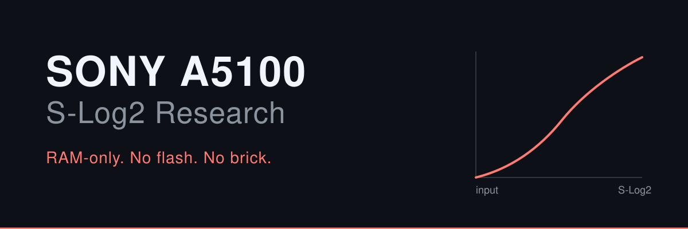
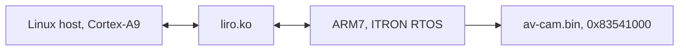

# Sony A5100 S-Log2 Research



> S-Log2 untuk Sony A5100. Patch RAM saja, tanpa flash, tanpa risiko brick.


## Quick Start

Detail lengkap ada di [`docs/REPRODUCE.md`](docs/REPRODUCE.md).

```bash
# 1. Patch capability gates di RAM (hilang setiap reboot, jalankan ulang)
python3 cam_cmd.py IP=<CAM_IP> "busybox ftpget -u cam -p cam -P 2121 <MAC_IP> /tmp/patch_avcam patch_avcam && chmod +x /tmp/patch_avcam && /tmp/patch_avcam"

# 2. Dump dan diff memori
python3 cam_cmd.py IP=<CAM_IP> "busybox ftpget ... /tmp/memdump memdump && /tmp/memdump 0x82df9000 0x7C000 /tmp/a.bin"

# 3. Verifikasi klip (target mutlak)
ffmpeg -i C0107.MP4 -vf signalstats -f null - 2>&1 | grep YMIN
```

## Status

Arsitektur kamera sudah dipetakan. Tiga capability gate bisa di-patch di RAM. Nilai S-Log2 sudah ketemu dan dikonfirmasi dua kali secara statis.

Tapi jujur: sampai hari ini belum ada satu pun klip video dengan kurva S-Log2 asli yang berhasil dibuat. Klip dinyatakan berhasil hanya kalau `ffmpeg -i clip.MP4 -vf signalstats` menghasilkan **YMIN >= 90**.

## Arsitektur



## Temuan Utama

| Temuan | Isi |
| --- | --- |
| Firmware ISP | `av-cam.bin` (11,2 MB, ITRON/ARM7) dimuat di RAM fisik **0x83541000** oleh `liro.ko`. Alamat Linux = alamat ARM7 + `0x40000000`. |
| Capability gates | ExGammaTableOn `0x83813dc4`, ul\_ExGammaTablePointer `0x83813dfc`, PictureProfile `0x838119d0`. Patch menjadi `movs r0,#0; bx lr`. |
| Nilai S-Log2 | **0x480** (domain MWF) = **indeks 10** (kabel SD). Wire PP SET `[0]=5, [3]=0x40, byte[0x1a]=indeks`. Parameter IPC gamma `0x238`. |
| Jalur Android | `setExtendedGammaTable` ternyata Picture Effect untuk foto, bukan Picture Profile untuk video. Histogram foto normal dan foto gamma identik. Dead end untuk video. |
| Kandidat Contrast | `0x82E4C40C`, u16 `0x3CE5` di -3 dan `0x3D05` di +3, delta `0x20` per langkah. Masih butuh protokol A==C. |
| Buffer LUT aktif | Belum ditemukan. Ini prioritas pertama untuk kontributor, lihat `docs/NEXT-STEPS.md`. |


## Kenapa Proyek Ini Ada

Saya filmmaker yang pernah mengguunakan sony A5100 sebagai kamera sehari-hari. sampai saat ini, masih banyak yang menggunakan kamera Sony Alpha tua yang belum memiliki fitur bawaan untuk merekam Log. Sony tidak pernah memberi S-Log di kamera ini, padahal A6300 ke atas dapat. Saya lihat Canon punya Magic Lantern, komunitas yang menambah fitur ke kamera lama lewat firmware. Saya tidak kejar RAW, saya kejar S-Log2, karena S-Log2 hanya ganti kurva gamma.  Dan semua hasil saya catat di sini, yang berhasil dan yang gagal.

## Keamanan

RAM-only. Tidak ada penulisan ke flash. Kamera kembali ke kondisi stock setelah reboot. Bukti yang sah hanya perubahan di LCD, histogram, atau klip. Nilai `return 0` bukan bukti.

Region `0xf1000000` dilarang untuk di-dump. Dua wedge sudah terkonfirmasi di sana. Baterai minimal 50 persen, dan kartu SD jangan diformat selama eksperimen.

## Dokumentasi

| Dokumen | Isi |
| --- | --- |
| [`docs/MASTER-TIMELINE.md`](docs/MASTER-TIMELINE.md) | Kronologi lengkap 2 sampai 9 November 2026 |
| [`docs/EXPERIMENTS.md`](docs/EXPERIMENTS.md) | Semua eksperimen, hasil, dan dead end |
| [`docs/ARCHITECTURE.md`](docs/ARCHITECTURE.md) | Dual-core, liro.ko, rantai IPC, alamat penting |
| [`docs/NEXT-STEPS.md`](docs/NEXT-STEPS.md) | Roadmap kontributor dan protokol eksperimen |
| [`docs/REPRODUCE.md`](docs/REPRODUCE.md) | Langkah demi langkah dari awal |
| [`docs/TOOLCHAIN-SETUP.md`](docs/TOOLCHAIN-SETUP.md) | Ghidra 12.1.4, REA, clang, lld, Android build tools |
| [`docs/TOOLS-INVENTORY.md`](docs/TOOLS-INVENTORY.md) | Semua tool, alasan dibuat, dan toolchain ARM |

Log mentah ada di `docs/session-logs/`, dokumen fase awal di `docs/legacy/`, analisis native di `docs/firmware-notes/`.

## Berkontribusi

Ketentuan lengkap ada di [`CONTRIBUTING.md`](CONTRIBUTING.md). Intinya: RAM-only, klaim harus didukung bukti fisik, dan region `0xf1000000` dilarang di-dump. Prioritas pertama bisa dikerjakan dengan satu kamera dalam sekitar 30 menit. Pull request yang menambah data ke `docs/EXPERIMENTS.md` selalu diterima, termasuk hasil yang gagal.

## Lisensi

MIT. Repo ini tidak menyertakan firmware Sony. Berkas seperti `av-cam.bin`, `libObj.so`, dan `libScalarDaemon.so` milik Sony. Kontributor mengekstrak sendiri dari firmware resmi miliknya.

Terima kasih kepada Magic Lantern dan OpenMemories/PMCA-RE, komunitas yang membuka jalan bagi proyek ini.